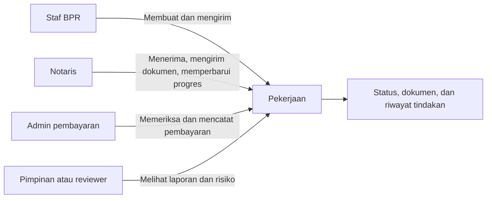
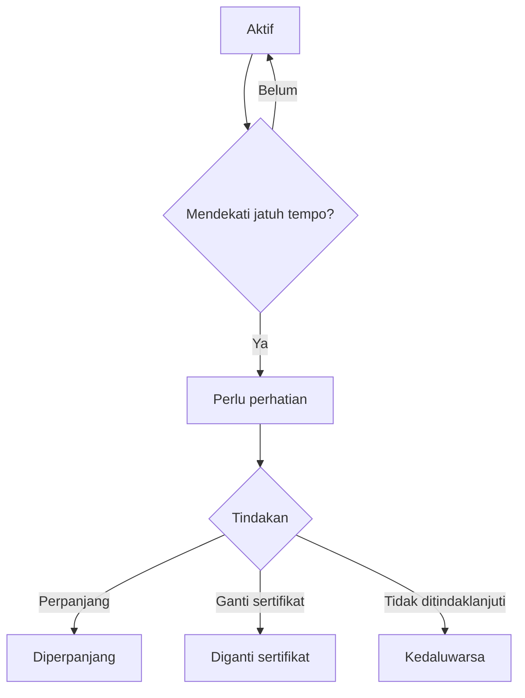

# Rancangan Proyek SIMONTOK

> **Status:** Draft untuk pembahasan
> **Tanggal:** 16 Oktober 2026
> **Nama proyek:** SIMONTOK — Sistem Monitoring Pekerjaan Notaris
> **Pengguna utama:** PT BPR BKK Jateng (Perseroda) dan notaris rekanan

---

## 1. Ringkasan Proyek

SIMONTOK adalah sistem untuk memantau seluruh pekerjaan notaris rekanan, mulai dari penugasan sampai dokumen selesai dan pembayaran diproses.

Saat ini, informasi pekerjaan, dokumen, progres, covernote, dan pembayaran berisiko tersebar di berbagai catatan atau percakapan. Akibatnya, staf perlu mencari informasi dari beberapa tempat, tindak lanjut dapat terlambat, dan pimpinan tidak selalu memperoleh gambaran terbaru mengenai pekerjaan yang sedang berjalan.

SIMONTOK menyatukan informasi tersebut dalam satu sistem. Setiap pekerjaan memiliki status, dokumen, pihak yang bertanggung jawab, dan riwayat perubahan yang dapat diperiksa kembali.

## 2. Masalah yang Ingin Diselesaikan

1. Status pekerjaan notaris tidak selalu terlihat dengan cepat.
2. Dokumen dan pembaruan progres dapat tersebar di beberapa kanal.
3. Sulit mengetahui pekerjaan mana yang sedang menunggu tindakan.
4. Risiko covernote mendekati jatuh tempo dapat terlambat ditindaklanjuti.
5. Proses pengajuan sampai pembayaran membutuhkan pemeriksaan dan pencatatan yang lebih tertib.
6. Saat diperlukan pemeriksaan, riwayat perubahan dan pihak yang melakukan tindakan belum selalu tersedia dalam satu tempat.

## 3. Tujuan Proyek

SIMONTOK ditujukan untuk:

- memberikan gambaran yang jelas mengenai seluruh pekerjaan notaris;
- membantu staf mengetahui pekerjaan yang perlu segera ditindaklanjuti;
- menyediakan tempat yang teratur untuk dokumen dan pembaruan progres;
- membantu mencegah covernote terlewat dari pemantauan;
- membuat proses pengajuan dan pembayaran lebih mudah diperiksa;
- menyediakan riwayat tindakan untuk kebutuhan pemeriksaan internal dan audit.

## 4. Cara Kerja SIMONTOK

Satu pekerjaan notaris berjalan melalui beberapa bagian berikut.

### A. Penugasan Pekerjaan

Staf BPR membuat pekerjaan baru dengan mencatat informasi yang diperlukan, seperti nasabah, rekening, cabang, notaris, dan jenis pekerjaan.

Setelah diperiksa, pekerjaan dikirim kepada notaris yang ditunjuk. Notaris kemudian dapat menerima pekerjaan tersebut atau menyampaikan alasan apabila tidak dapat mengerjakannya.

### B. Pemeriksaan dan Pengiriman Dokumen

Notaris mengunggah dokumen sesuai tahap pekerjaan. Staf BPR memeriksa dokumen tersebut dan dapat:

- menyatakan dokumen sudah sesuai;
- meminta perbaikan;
- menerima dokumen final; atau
- menolak dokumen dengan alasan yang jelas.

Dengan demikian, pihak BPR dan notaris dapat melihat dokumen serta hasil pemeriksaannya dari pekerjaan yang sama.

### C. Pembaruan Progres Pekerjaan

Notaris mencatat perkembangan pekerjaan, termasuk proses akta, BPN/Samsat, atau tahap lain sesuai jenis pekerjaan. Staf BPR dapat melihat perkembangan tersebut tanpa harus meminta pembaruan melalui banyak kanal.

### D. Pemantauan Covernote

SIMONTOK mencatat covernote yang terkait dengan pekerjaan dan memberi tanda apabila masa berlakunya mendekati jatuh tempo.

Staf BPR dapat melihat covernote yang:

- masih aktif;
- mendekati jatuh tempo;
- sudah diperpanjang;
- sudah diganti dengan sertifikat; atau
- sudah kedaluwarsa.

Jika diperlukan, tindakan perpanjangan atau penggantian dapat dicatat bersama riwayatnya.

### E. Pengajuan dan Pembayaran

Notaris mengajukan pembayaran melalui pekerjaan yang bersangkutan dan melampirkan dokumen pendukung. Selanjutnya:

1. Admin memeriksa pengajuan.
2. Pengajuan dapat dikembalikan apabila ada kekurangan.
3. Pihak yang berwenang memberikan persetujuan atau penolakan.
4. Pembayaran dicatat setelah benar-benar dilakukan.
5. Bukti pembayaran disimpan pada pekerjaan tersebut.

Setiap tahap memiliki status sehingga pihak terkait dapat mengetahui posisi pengajuan tanpa menebak-nebak.

### Diagram 1: Alur Besar Pekerjaan

```mermaid
flowchart LR
    A[Buat pekerjaan] --> B[Kirim ke notaris]
    B --> C[Notaris menerima]
    C --> D[Dokumen dan progres]
    D --> E[Pemeriksaan BPR]
    E -->|Perlu perbaikan| D
    E -->|Sudah sesuai| F[Dokumen final]
    F --> G[Serah terima]
    G --> H[Pengajuan pembayaran]
    H --> I[Pemeriksaan dan persetujuan]
    I -->|Perlu perbaikan| H
    I -->|Disetujui| J[Pembayaran]
    J --> K[Selesai]
```

Diagram ini menunjukkan perjalanan normal satu pekerjaan. Jika dokumen atau pengajuan belum sesuai, proses kembali ke tahap perbaikan tanpa membuat pekerjaan baru.

## 5. Contoh Perjalanan Satu Pekerjaan

1. Cabang atau staf BPR membuat pekerjaan baru.
2. Pekerjaan dikirim kepada notaris rekanan.
3. Notaris menerima pekerjaan.
4. Notaris mengirim dokumen awal.
5. BPR memeriksa dokumen dan meminta perbaikan bila diperlukan.
6. Notaris memperbarui progres sampai pekerjaan akta dan BPN/Samsat selesai.
7. Notaris mengirim draft dan dokumen final.
8. BPR memeriksa serta menerima dokumen final.
9. Dokumen fisik diserahkan dan penerimaannya dicatat.
10. Notaris mengajukan pembayaran.
11. Pengajuan diperiksa, disetujui, dan dibayar sesuai kewenangan.
12. Pekerjaan ditutup setelah seluruh kewajiban selesai.

Pada setiap tahap, sistem menyimpan status, dokumen, waktu, dan pihak yang melakukan tindakan.

### Diagram 2: Pembagian Peran

Diagram ini menjelaskan bahwa semua pihak bekerja pada pekerjaan yang sama, dengan tanggung jawab yang berbeda.

### Diagram 3: Pemantauan Covernote

Diagram ini membantu menjelaskan mengapa covernote perlu dipantau sebelum tanggal berlakunya habis.

## 6. Siapa yang Menggunakan

### Staf BPR

Membuat pekerjaan, mengirim penugasan, memeriksa dokumen, melihat progres, memantau covernote, dan menindaklanjuti pekerjaan yang tertunda.

### Notaris Rekanan

Melihat pekerjaan yang ditugaskan, menerima pekerjaan, mengirim dokumen, memperbarui progres, dan mengajukan pembayaran.

### Admin Pembayaran

Memeriksa kelengkapan pengajuan, memproses persetujuan sesuai kewenangan, mencatat pembayaran, dan menyimpan bukti pembayaran.

### Pimpinan atau Reviewer

Melihat ringkasan pekerjaan, mengetahui risiko atau keterlambatan, memeriksa laporan, dan meninjau riwayat tindakan.

### Admin Sistem

Mengelola data cabang, notaris, jenis pekerjaan, pengguna, dan pembagian kewenangan.

## 7. Ruang Lingkup Tahap Awal

### Termasuk

- data cabang, notaris, jenis pekerjaan, dan pengguna;
- pembuatan serta pemantauan pekerjaan;
- portal untuk notaris rekanan;
- pengiriman dan pemeriksaan dokumen;
- pembaruan progres pekerjaan;
- pemantauan covernote dan jatuh tempo;
- pengajuan, persetujuan, dan pencatatan pembayaran;
- pemberitahuan untuk tindakan penting;
- laporan ringkas;
- riwayat perubahan dan tindakan.

### Belum Termasuk

- menggantikan sistem inti perbankan atau sistem akuntansi;
- mengambil keputusan hukum, kredit, atau persetujuan manajemen secara otomatis;
- aplikasi khusus Android atau iPhone;
- integrasi dengan sistem lain sebelum kebutuhan dan keamanannya disepakati;
- pengiriman informasi ke pihak luar melalui kanal tambahan sebelum ada persetujuan organisasi.

## 8. Manfaat yang Diharapkan

### Untuk BPR

- Pekerjaan notaris lebih mudah dipantau.
- Pekerjaan yang tertunda atau membutuhkan tindakan lebih cepat terlihat.
- Dokumen dan progres tersimpan bersama pekerjaan terkait.
- Pemantauan covernote menjadi lebih teratur.
- Proses pembayaran memiliki urutan dan bukti yang jelas.
- Pemeriksaan internal tidak perlu mengumpulkan bukti dari banyak tempat.

### Untuk Notaris

- Penugasan dapat dilihat dari satu tempat.
- Dokumen dan progres dapat dikirim melalui pekerjaan yang sama.
- Kekurangan atau perbaikan dapat diketahui dengan jelas.
- Status pengajuan pembayaran dapat dipantau.

### Untuk Pimpinan

- Memperoleh gambaran pekerjaan yang sedang berjalan.
- Mengetahui bagian yang mengalami hambatan.
- Melihat risiko covernote dan pembayaran yang perlu perhatian.
- Memiliki dasar informasi yang lebih baik untuk evaluasi dan pengawasan.

## 9. Prinsip Penggunaan

- **Satu pekerjaan, satu tempat:** informasi terkait pekerjaan disimpan pada pekerjaan yang sama.
- **Status harus mudah dipahami:** setiap status menjelaskan posisi pekerjaan dan tindakan berikutnya.
- **Bukti menyertai proses:** dokumen, alasan, waktu, dan pihak yang bertindak dicatat bersama pekerjaannya.
- **Akses sesuai kewenangan:** setiap pengguna hanya melihat dan melakukan hal yang menjadi tanggung jawabnya.
- **Mudah diperiksa kembali:** riwayat pekerjaan dapat digunakan untuk klarifikasi dan pemeriksaan.

## 10. Hal yang Perlu Disepakati

Sebelum SIMONTOK digunakan secara luas, beberapa hal berikut perlu disepakati oleh pemilik proses:

1. Siapa yang berwenang membuat, memeriksa, menyetujui, dan menutup pekerjaan?
2. Berapa lama batas waktu yang dianggap wajar untuk setiap jenis pekerjaan?
3. Berapa hari sebelum jatuh tempo covernote harus diberi tanda perhatian?
4. Dokumen apa saja yang wajib tersedia pada setiap jenis pekerjaan?
5. Siapa yang berwenang menyetujui pembayaran?
6. Bagaimana cara memperbaiki kesalahan pencatatan?
7. Berapa lama dokumen dan riwayat pekerjaan harus disimpan?
8. Siapa yang menjadi penanggung jawab utama SIMONTOK setelah digunakan?

## 11. Ukuran Keberhasilan

Keberhasilan SIMONTOK akan dilihat dari hal-hal berikut:

- seluruh pekerjaan baru tercatat dengan informasi dasar yang lengkap;
- staf dapat mengetahui pekerjaan yang membutuhkan tindakan;
- notaris dapat mengirim dokumen dan progres melalui sistem;
- covernote yang mendekati jatuh tempo terlihat sebelum terlambat;
- pengajuan pembayaran memiliki status dan bukti yang jelas;
- riwayat tindakan tersedia ketika diperlukan untuk pemeriksaan.

Angka sasaran dan cara pengukurannya ditetapkan setelah pemilik proses menyepakati kondisi awal di lapangan.

## 12. Penutup

SIMONTOK bukan sekadar tempat menyimpan data. Proyek ini ditujukan untuk menertibkan perjalanan pekerjaan notaris agar pihak BPR, notaris, admin pembayaran, dan pimpinan memiliki pemahaman yang sama mengenai:

- pekerjaan apa yang sedang berjalan;
- siapa yang sedang bertanggung jawab;
- dokumen apa yang sudah atau belum lengkap;
- tindakan apa yang perlu dilakukan berikutnya; dan
- bukti apa yang tersedia bila pekerjaan perlu diperiksa kembali.

Dokumen ini menjadi bahan pembahasan awal. Setelah alur dan pembagian kewenangan disepakati, rincian pelaksanaan dapat disusun oleh tim terkait.
